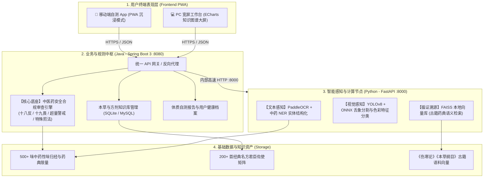
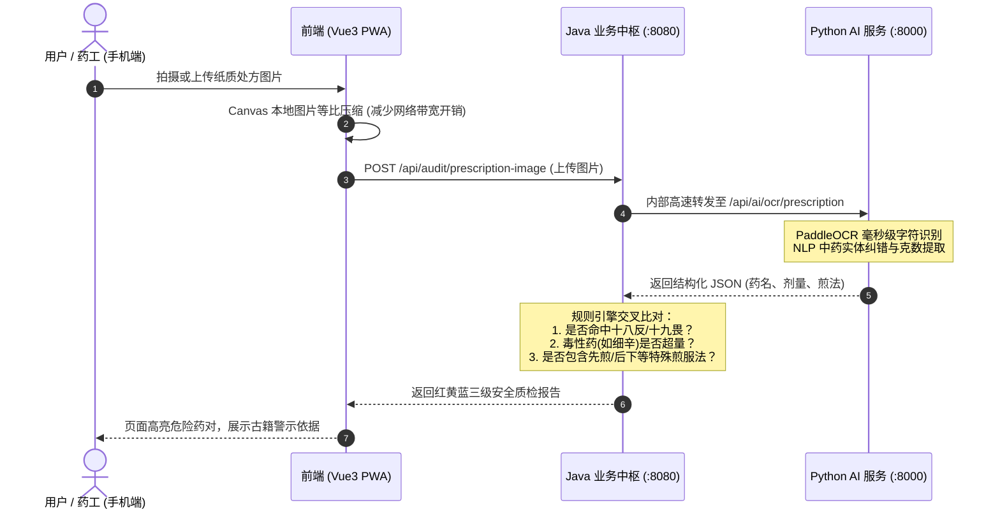
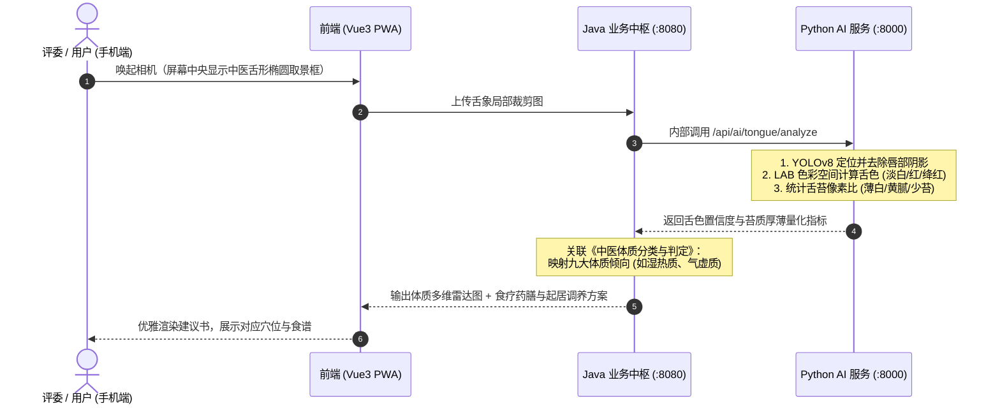

# 岐黄盾 (HerbShield) —— 整体架构蓝图与开发大纲 (Master Blueprint)

> **竞赛定位**：南京中医药大学第十九届“挑战杯”大学生课外学术科技作品竞赛（科技发明制作 B 类 - 信息技术组）  
> **文档版本**：v1.0.0 (2026-11-01)  
> **核心架构**：Vue 3 PWA 前端 + Spring Boot 3 Java 业务与规则中枢 + FastAPI Python AI 感知节点

---

## 一、 项目定位与核心使命

1. **核心使命**：“识本草之微，杜配伍之害 —— 每个人口袋里的中药安全与调养助手”。
2. **解决痛点**：
   - 解决纸质中药处方流转中“十八反、十九畏、有毒药材超量”人工核对易疏漏的痛点；
   - 解决大众盲目自服中成药与药膳、不知自身体质与药性相克的隐患；
   - 解决中医药古方与现代药理循证检索门槛高的难题。
3. **合规红线保障**：严格定位于“用药安全核对、日常健康调摄、中医药文化科普与辅助学习”，页面与报告强制附带“不构成临床诊断与处方凭证”免责声明，杜绝医疗纠纷与非法行医合规风险。

---

## 二、 整体分层系统架构

系统采用 **“端-网-边-芯”现代异构微服务解耦设计**：



---

## 三、 两大核心业务闭环时序逻辑

### 1. 【拍处方 · 查禁忌】处方安全质检闭环


### 2. 【拍舌苔 · 辨体质】多模态视觉辨识闭环


---

## 四、 网络拓扑与零信任穿透部署方案

针对现有资源（国内未备案服务器 + Cloudflare 托管域名 `tcm.084623224.xyz`），采用出站加密隧道架构：

```
                    [ 评委手机 (微信/Safari/Chrome) / PC 浏览器 ]
                                          │
                                          ▼  HTTPS (tcm.084623224.xyz)
                            [ Cloudflare Edge 全球 Anycast CDN ]
                              - 自动终止 SSL，颁发受信证书 (契合 PWA 强制 HTTPS)
                              - 静态缓存加速
                                          │
                                          ▼  加密出站隧道 (QUIC/7844 端口)
                        ┌───────────────────────────────────────────────┐
                        │   国内云服务器 (运行 cloudflared 守护进程)    │
                        │                                               │
                        │   [ 本地反向代理 / Nginx (Port 80/443) ]      │
                        │      ├─ 静态资源托管: 前端构建产物 (dist)     │
                        │      └─ 动态接口代理: 转发至 8080              │
                        │                                               │
                        │   [ Java 业务服务 (Spring Boot 3 :8080) ]     │
                        │      └─ 内部调用 127.0.0.1:8000               │
                        │                                               │
                        │   [ Python AI 节点 (FastAPI :8000) ]          │
                        └───────────────────────────────────────────────┘
```

---

## 五、 各工程模块职责与技术选型

| 模块目录 | 核心技术栈 | 职责边界 | 关键交付物 |
| :--- | :--- | :--- | :--- |
| **`frontend/`** | Vue 3 + Vite + Tailwind CSS + Vant 4 + ECharts + PWA | 1. 移动端相机取景与前端即时压缩<br>2. 质检结果红绿灯与体质多维雷达图呈现<br>3. PC 端力导向知识图谱大屏交互<br>4. PWA 桌面化独立运行与离线静态秒开 | 响应式前端 Web/PWA 应用 |
| **`backend-java/`** | Spring Boot 3 + JDK 21 + 规则引擎 + Fastjson2 | 1. 统一对外 API 网关与业务防线<br>2. 【十八反/十九畏】集合碰撞规则引擎<br>3. 药典极量超量预警逻辑<br>4. 统一调度协调 Python AI 计算服务 | 业务中枢微服务 Jar 包 |
| **`backend-python/`**| FastAPI + PaddleOCR + YOLO/ONNX + FAISS | 1. 纸质处方 OCR 极速字符识别与实体纠错<br>2. 数字舌象目标检测与色彩空间特征量化<br>3. 中医古籍文献语义 RAG 检索召回 | 内部无状态 AI 计算微服务 |
| **`docs/`** | Markdown / JSON | 1. 接口规范 (`API_CONTRACT.md`)<br>2. 规则数据字典 (`DATA_DICTIONARY.md`)<br>3. 附件5申报书与技术设计报告初稿 | 竞赛文本与设计资产 |

---

## 六、 研发推进冲刺大纲（里程碑规划）

```
[阶段一：基座验证] ───> [阶段二：核心业务与AI] ───> [阶段三：双端呈现与联调] ───> [阶段四：申报与视频打包]
 (10.31 ~ 11.02)         (11.03 ~ 11.06)            (11.07 ~ 11.09)             (11.10 ~ 11.13)
```

1. **阶段一：基座搭建与穿透验证 (已完成部分骨架)**
   - 前后端基础代码骨架就绪；
   - 服务器安装 `cloudflared`，验证公网域名可访问健康检查接口。
2. **阶段二：中药规则引擎与 AI 感知服务**
   - Java 端实现十八反、十九畏与剂量审查算法；
   - Python 端跑通 PaddleOCR 处方提取与 ONNX 舌象分析模块；
   - 验证 Java 对 Python 内部接口调用的连通性。
3. **阶段三：前端交互闭环与 ECharts 知识大屏**
   - 手机端实现相机调用、取景框引导与自测报告渲染；
   - PC 端接入 ECharts 力导向知识图谱，实现节点拖拽下钻；
   - PWA 配置完善，实现一键“添加到主屏幕”。
4. **阶段四：申报材料润色与演示录屏**
   - 录制 2~3 分钟清晰操作录屏（MP4 格式）；
   - 依照官方格式撰写 12~15 页《B3 技术设计报告》；
   - 填报《附件5：作品申报书》，在系统截止前正式提交。
